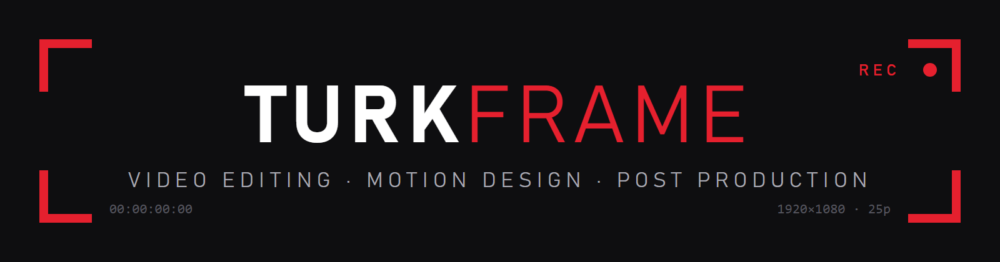

  

## 🎬 Merhaba, ben Berk

Video editörü ve motion tasarımcısıyım. Kurgu, hareketli grafik ve post prodüksiyon üzerine çalışıyorum;
bu hesapta iş akışımı hızlandıran araçları, şablonları ve projelerimi paylaşıyorum.

- 🎞️ **Kurgu:** EDIUS, haber / belgesel / tanıtım filmi
- ✨ **Motion:** kinetik tipografi, alt yazı ve jenerik tasarımı
- 🗂️ **Arşiv:** video ve fotoğraf arşivi düzenleme, otomasyon scriptleri
- 🌱 **Şu an öğreniyorum:** Python ile otomasyon, DaVinci Resolve'da renk düzenleme, video üretiminde yapay zekâ araçları

---

### 🛠️ Kullandığım araçlar

  
  
  
  
  

<!-- Kullanmadığın aracın satırını sil, kullandığın yenisini aynı kalıpla ekle. -->

---

### 📂 Öne çıkan projeler

| Proje | Açıklama |
|---|---|
| 🎞️ *yakında* | İlk repoyu açınca burayı güncelle |

● REC — turkframe

